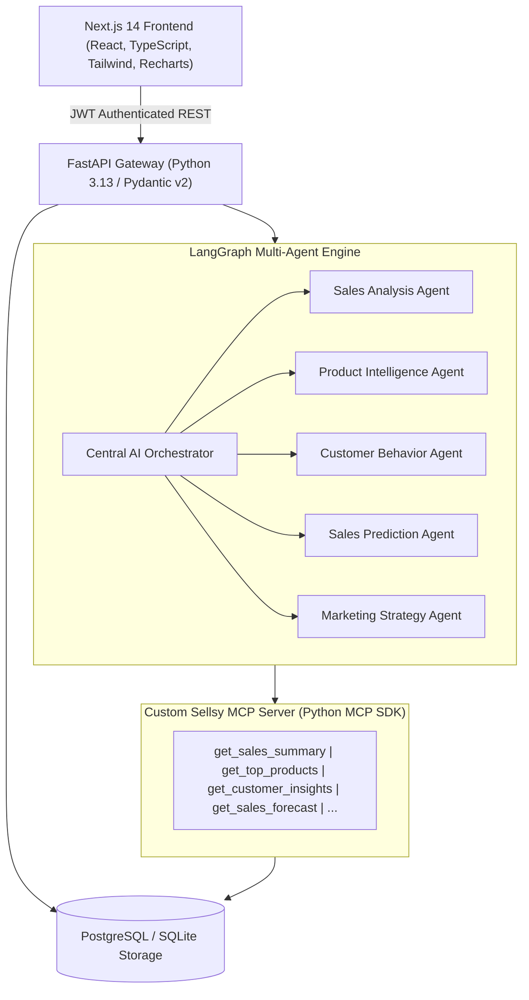

# SELLSY
### AI-Powered E-commerce Intelligence & Growth Platform

> **"Understand Your Store. Make Smarter Decisions."**

[](https://nextjs.org/)
[](https://fastapi.tiangolo.com/)
[](https://python.org/)
[](https://langchain-ai.github.io/langgraph/)
[](https://modelcontextprotocol.io/)
[](https://tailwindcss.com/)

---

## 1. Product Vision & Executive Summary

**Sellsy** is an enterprise-grade, full-stack AI e-commerce intelligence SaaS platform designed for store owners, online retailers, and D2C brands. It bridges the gap between raw, overwhelming store statistics and actionable growth decisions by utilizing an autonomous multi-agent orchestration architecture powered by **LangGraph**, **Google Gemini**, **Model Context Protocol (MCP)**, and **statistical time-series forecasting**.

Rather than presenting static vanity metrics or disconnected chatbots, Sellsy actively interprets store dynamics: identifying why revenue changed, highlighting catalog stars vs. declining inventory, calculating verified customer RFM retention rates, predicting future demand with confidence bands, and drafting grounded marketing blueprints.

---

## 2. Key Platform Features

- **Executive Performance Hub (Overview Dashboard):**
  - KPI summary cards with period deltas: Total Revenue, Total Orders, Average Order Value (AOV), Total Customers, Benchmark Conversion Rate, and Revenue Growth.
  - Interactive revenue timeline (Recharts) and category distribution donut.
  - Top-selling products and live recent orders feed.
  - Autonomous AI business insights panel with confidence ratings and recommended actions.

- **Sales Analytics:**
  - Continuous chronological trends with 7, 30, and 90-day timeframes.
  - Granular period-over-period variance benchmarks and daily performance ledger.
  - Sales Analysis Agent narrative explaining growth catalysts (e.g. weekend order surges).

- **Product Intelligence:**
  - SKU-level velocity classification: *Catalog Stars*, *Declining Items*, *Opportunities*, and *Stable*.
  - Margin analysis, unit sales, inventory health, and monthly breakdown drawer.

- **Customer Insights & RFM Segmentation:**
  - Behavioral customer cohorts: *High-Value VIPs*, *Returning Loyalists*, *New Buyers*, *At-Risk Customers*, and *Inactive Shoppers*.
  - Verified cohort Repeat Purchase Rate (RPR) and Average Customer Lifetime Value (LTV).
  - Data-grounded retention playbooks.

- **Statistical Sales Forecasting:**
  - 30, 60, and 90-day predictive horizons using **Holt's Linear Exponential Smoothing**.
  - Continuous charts displaying historical sales actuals transitioning into projected revenue with 80% Gaussian confidence bands.
  - Warehouse fulfillment order estimations.

- **AI Marketing Advisor:**
  - Tactical campaign blueprints with targeted segments, recommended channels, hero offers, and execution checklists.
  - High-impact quick wins and cross-sell catalog pairings to lift basket AOV.

- **Sellsy AI Conversational Assistant:**
  - Full-screen conversational intelligence interface.
  - Powered by live database tool calls via the **Model Context Protocol (MCP)**.
  - Interactive tool execution badges showing exact arguments and outputs.
  - Grounded numerical citations with zero hallucinations.

- **Executive Reports & Exports:**
  - One-click compilation of verified **PDF dossiers** (via ReportLab) and **CSV tables**.
  - Clearly distinguishes calculated database metrics from AI strategic synthesis.

- **Store Integrations & CSV Ingestion:**
  - Shopify Admin API connection handshake and synchronization check.
  - Custom CSV import engine for Products, Orders, and Customers with automated column mapping, duplicate detection, and import previews.

---

## 3. System Architecture & Tech Stack



### Technology Matrix
- **Frontend:** Next.js 14+ (App Router), TypeScript, Tailwind CSS, Lucide React, Recharts.
- **Backend:** Python 3.13, FastAPI, Pydantic v2, SQLAlchemy, ReportLab, Pandas, NumPy.
- **AI & Multi-Agent:** LangGraph StateGraph, Google Gemini API.
- **MCP Integration:** Official Python MCP SDK (`mcp`).
- **Database:** PostgreSQL (Railway production) / SQLite (zero-friction local development).
- **Deployment:** Railway (Backend + PostgreSQL), Vercel (Frontend).

---

## 4. Evaluator Demo Mode

Sellsy includes an automated, reproducible demo seeding engine that pre-populates realistic e-commerce data:
- **Demo Account:** `demo@sellsy.io`
- **Demo Password:** `demo123456`
- **Demo Store:** *Aura Living Essentials* (`auraliving.myshopify.com`)
- **Seeded Catalog:** 25 realistic lifestyle products across 4 categories with pricing, COGS, inventory, and SKU identifiers.
- **Seeded Orders:** 175+ completed orders spanning the last 90 days with weekend volume surges and realistic AOV ($117.02).
- **Seeded Cohorts:** 45 customers categorized into High-Value VIPs, Returning Loyalists, and At-Risk groups.

### One-Click Evaluation:
On the login screen (`/login`), click **"Launch Instant Demo Account"** to immediately access the fully populated dashboard without manual credential entry!

---

## 5. Local Quickstart Guide

### Prerequisites
- Python 3.11+ (Python 3.13 supported)
- Node.js 18+ & npm

### 1. Backend Setup
```bash
cd backend
python -m venv .venv

# Activate virtual environment
# Windows:
.venv\Scripts\activate
# macOS/Linux:
source .venv/bin/activate

# Install dependencies
pip install -r requirements.txt

# Run backend verification test suite
python test_backend.py

# Start FastAPI server
python -m uvicorn app.main:app --reload --port 8000
```
*The backend automatically creates the database and seeds the demo store on startup.*

### 2. Frontend Setup
```bash
cd frontend

# Install npm dependencies
npm install

# Start Next.js development server
npm run dev
```

Visit `http://localhost:3000` to explore Sellsy.

---

## 6. Model Context Protocol (MCP) Server

Sellsy implements a dedicated MCP server (`backend/app/mcp/server.py`) using the official Python MCP SDK:
- `get_sales_summary(store_id, days)`
- `get_top_products(store_id, limit, metric)`
- `get_product_performance(store_id, product_id)`
- `get_customer_insights(store_id)`
- `get_revenue_trends(store_id, days)`
- `get_sales_forecast(store_id, days_ahead)`
- `get_recent_orders(store_id, limit)`
- `generate_business_report(store_id, report_type)`

Run the standalone MCP server:
```bash
cd backend
python -m app.mcp.server
```

---

## 7. Reusable AI Skills

Sellsy packages analytical guidelines into reusable Skill definition files in `skills/`:
- `skills/sales-analysis/SKILL.md`
- `skills/product-intelligence/SKILL.md`
- `skills/customer-insights/SKILL.md`
- `skills/sales-forecasting/SKILL.md`
- `skills/marketing-strategy/SKILL.md`

Each skill defines required inputs, mathematical instructions, tool usage rules, output schemas, and validation constraints.

---

## 8. Team Division of Work

Developed by a dedicated 2-member team:

- **Team Member 1 (Frontend & Product Engineering):**
  - UI/UX Design System, Next.js 14 App Router, Recharts Data Visualizations, Collapsible Sidebar Layout, Authentication Interface, Client-side API Client, Vercel Production Deployment.

- **Team Member 2 (Backend & AI Engineering):**
  - FastAPI Modular Architecture, SQLAlchemy Relational Schema, LangGraph Multi-Agent Orchestrator, Custom Sellsy MCP Server, Reusable AI Skills, Holt Exponential Smoothing Forecasting, ReportLab PDF Engine, Railway Deployment.

---

## 9. License & Capstone Deliverable

Developed as a professional capstone project demonstrating modern agentic AI engineering, MCP integration, and full-stack SaaS architecture.

