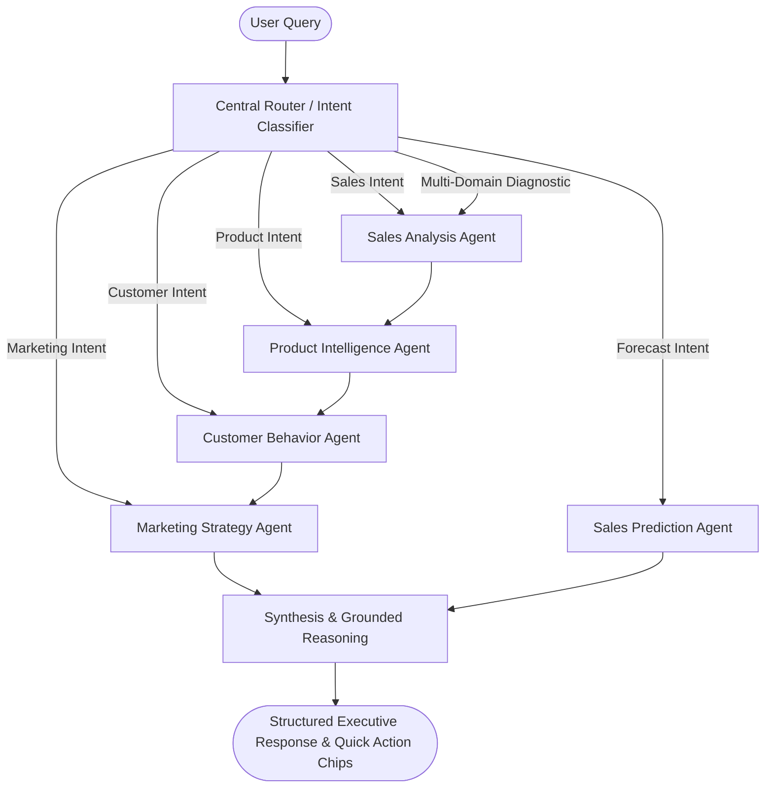

# LangGraph Multi-Agent Architecture & Orchestration

---

## 1. Overview

Sellsy rejects monolithic prompts in favor of an orchestrated multi-agent network compiled with **LangGraph**. A centralized orchestrator receives merchant queries, extracts operational intent, dispatches tasks to specialized analytical agents, and consolidates intermediate findings into an executive report.

---

## 2. Agent Graph State Machine

---

## 3. Specialized Agent Specifications

### Agent 1: Sales Analysis Agent
- **Role:** Evaluates period-over-period turnover, order counts, and AOV deltas.
- **Tools Invoked:** `get_sales_summary`, `get_revenue_trends`.
- **Governing Skill:** `skills/sales-analysis/SKILL.md`.

### Agent 2: Product Intelligence Agent
- **Role:** Analyzes SKU margins, velocity trends, and identifies declining products.
- **Tools Invoked:** `get_top_products`, `get_product_performance`.
- **Governing Skill:** `skills/product-intelligence/SKILL.md`.

### Agent 3: Customer Behavior Agent
- **Role:** Segments customers into RFM tiers (VIP, Returning, New, At-Risk, Inactive) and calculates repeat purchase rates.
- **Tools Invoked:** `get_customer_insights`.
- **Governing Skill:** `skills/customer-insights/SKILL.md`.

### Agent 4: Sales Prediction Agent
- **Role:** Computes Holt linear exponential smoothing models and estimates demand volume.
- **Tools Invoked:** `get_sales_forecast`.
- **Governing Skill:** `skills/sales-forecasting/SKILL.md`.

### Agent 5: Marketing Strategy Agent
- **Role:** Generates actionable growth campaigns, hero product offers, and retention triggers.
- **Tools Invoked:** `generate_marketing_strategy`.
- **Governing Skill:** `skills/marketing-strategy/SKILL.md`.

