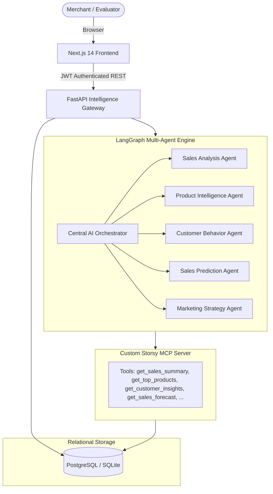

# Storsy: Technical Architecture & System Design

---

## 1. System Overview

**Storsy** is an AI-powered e-commerce intelligence and growth SaaS platform built with a high-throughput, decoupled architecture:
- **Frontend Layer:** Next.js 14+ (App Router), TypeScript, Tailwind CSS, Recharts, and Lucide Icons.
- **API & Intelligence Layer:** FastAPI (Python 3.13), Pydantic v2, and RESTful service layer.
- **Multi-Agent Orchestration Layer:** LangGraph StateGraph governing 5 specialized autonomous agents.
- **Model Context Protocol (MCP) Server:** Custom Python MCP server using the official Python MCP SDK (`mcp`).
- **Data Layer:** PostgreSQL (Railway) with SQLAlchemy ORM, indexed analytics rollups, and zero-friction SQLite local development fallback.

---

## 2. Multi-Agent Orchestration (LangGraph)

Instead of a single unstructured prompt, Storsy implements a multi-agent state graph where each specialist executes its corresponding skills and tools:
1. **Sales Analysis Agent:** Evaluates gross sales, order volume, AOV, and period-over-period growth deltas ($\Delta\%$).
2. **Product Intelligence Agent:** Evaluates SKU velocities, profit margins, catalog stars, and declining items.
3. **Customer Behavior Agent:** Segments shoppers into RFM cohorts (VIP, Returning, New, At-Risk, Inactive) and calculates repeat purchase rates.
4. **Sales Prediction Agent:** Fits Holt's linear exponential smoothing time-series model with 80% confidence bands.
5. **Marketing Strategy Agent:** Synthesizes discoveries into concrete marketing campaign blueprints, quick wins, and cross-sell pairings.
6. **Central Orchestrator:** Routes intent, coordinates execution sequencing, and produces executive synthesis.

---

## 3. Security & Multi-Tenant Data Isolation

- **Authentication:** Standard OAuth2 Password Bearer with HMAC-SHA256 JWT tokens.
- **Password Protection:** Direct salted bcrypt hashing with strict 72-byte truncation guardrails.
- **Store-Level Isolation:** All analytical queries, products, orders, and customer records are explicitly scoped by foreign key `store_id` matching the authenticated user.

