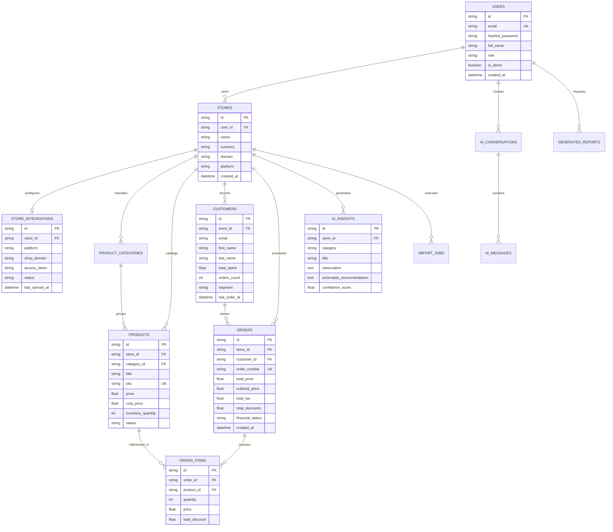

# Database Design & Entity Relationship (ER) Model

---

## 1. Relational Database Overview

Sellsy utilizes a PostgreSQL relational schema engineered for rapid analytical aggregation, foreign key referential integrity, and multi-tenant data isolation.

---

## 2. Entity-Relationship Diagram

---

## 3. Database Indexes

- `idx_store_date`: Indexed on `(store_id, date)` for sub-millisecond daily rollups.
- `idx_orders_store_created`: Indexed on `(store_id, created_at)` for rolling window queries.
- `idx_products_sku`: Indexed on `(store_id, sku)` for fast catalog lookups and duplicate detection during CSV ingestion.
- `idx_customers_email`: Indexed on `(store_id, email)` for customer cohort tracking.
